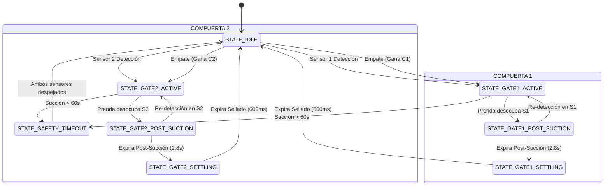

# Controlador de Doble Compuerta para Succionadora de Lavandería Industrial

[](https://www.arduino.cc/)
[]()
[]()

Firmware industrial en C++ desarrollado para microcontroladores **Microchip ATmega328P (Arduino Uno / Nano)** que gestiona la automatización y el enclavamiento mutuo (*interlock*) de un sistema de doble compuerta de aspiración en túneles/ductos de transporte neumático para lavanderías industriales.

---

## 📋 Tabla de Contenidos
1. [Descripción del Sistema](#-descripción-del-sistema)
2. [Características Principales](#-características-principales)
3. [Máquina de Estados Finitos (FSM)](#-máquina-de-estados-finitos-fsm)
4. [Lógica de Enclavamiento y Arbitraje](#-lógica-de-enclavamiento-y-arbitraje)
5. [Estructura del Proyecto](#-estructura-del-proyecto)
6. [Mapeo de Pines (Hardware Pinout)](#-mapeo-de-pines-hardware-pinout)
7. [Instalación y Configuración](#-instalación-y-configuración)
8. [Aislamiento Eléctrico y Cargas Inductivas](#-aislamiento-eléctrico-y-cargas-inductivas)
9. [Guía de Pruebas de Puesta en Marcha](#-guía-de-pruebas-de-puesta-en-marcha)

---

## 🏭 Descripción del Sistema

En una lavandería industrial, los operarios introducen prendas en distintas tolvas o estaciones de carga conectadas a una **única turbina central de vacío de alta potencia**. Si ambas compuertas se abren simultáneamente, la depresión en el ducto cae drásticamente, provocando atascos de ropa y riesgo de sobrecarga del motor.

Este controlador garantiza que:
1. **Enclavamiento Férreo (Mutual Interlock):** Solo una compuerta puede estar abierta a la vez. Mientras una está operando, la otra queda completamente ignorada y bloqueada.
2. **Post-Succión Completa (Overrun Timer):** Cuando el sensor deja de detectar la prenda, el motor y la compuerta continúan activos por un periodo programable (2.8 s por defecto), asegurando que la prenda recorra la totalidad del ducto de extracción sin frenarse.
3. **Margen de Cierre Mecánico (Settling Dead-Time):** Al terminar la succión, el motor se apaga y la compuerta se cierra, aplicando un retardo de seguridad (600 ms) antes de habilitar el enclavamiento a la compuerta contraria. Esto permite el sellado neumático y disipación de inercia de aire.
4. **Protección Térmica por Atasco (Safety Watchdog):** Si un sensor permanece obstruido por más de 60 segundos (p. ej. prenda enredada en la boca o sensor sucio), el sistema apaga el motor para evitar quemar la turbina y señaliza alarma.

---

## ⚡ Características Principales

- **100% No Bloqueante (`millis()`):** Sin ningún uso de `delay()` en el bucle principal. Frecuencia de ciclo > 5 kHz.
- **Filtro Antirrebote Configurable:** Algoritmo temporal para inmunidad contra vibración mecánica, pelusa flotante y transitorios.
- **Doble Modalidad de Actuador:** Selección inmediata en `Config.h` entre:
  - `ACTUATOR_MODE_RELAY`: Electroválvulas neumáticas 24V vía relé.
  - `ACTUATOR_MODE_SERVO`: Servomotores de control angular PWM.
- **Perro Guardián de Hardware (AVR WDT @ 2s):** Recuperación automática ante cuelgues causados por EMI de contactores de potencia.
- **Resolución Determinista de Empates:** Algoritmo *Round-Robin* que evita la hambruna de estaciones si ambos sensores se activan en el mismo milisegundo.
- **Diagnóstico y Telemetría por UART:** Trazabilidad clara de estados y tiempos a 115200 bps.

---

## 🔄 Máquina de Estados Finitos (FSM)



---

## 🔒 Lógica de Enclavamiento y Arbitraje

| Estado Actual | Señal Sensor 1 | Señal Sensor 2 | Acción Ejecutada | Enclavamiento |
| :--- | :---: | :---: | :--- | :--- |
| **IDLE** | Inactivo | Inactivo | Motor OFF, C1 Cerrada, C2 Cerrada | Ambos habilitados |
| **IDLE** | **ACTIVO** | Inactivo | Abre C1, Motor ON -> `GATE1_ACTIVE` | **C2 BLOQUEADA** |
| **IDLE** | Inactivo | **ACTIVO** | Abre C2, Motor ON -> `GATE2_ACTIVE` | **C1 BLOQUEADA** |
| **IDLE** | **ACTIVO** | **ACTIVO** | Arbitraje Round-Robin determinista | Compuerta perdedora bloqueada |
| **GATE1_ACTIVE / POST** | X | **ACTIVO** | **IGNORADO**. Sensor 2 no tiene efecto | **C2 BLOQUEADA** |
| **GATE2_ACTIVE / POST** | **ACTIVO** | X | **IGNORADO**. Sensor 1 no tiene efecto | **C1 BLOQUEADA** |
| **SETTLING (Transición)** | Activo / Inact | Activo / Inact | **IGNORADOS AMBOS**. Esperando sellado físico | **AMBAS BLOQUEADAS** |

---

## 📂 Estructura del Proyecto

```
succionadora-industrial-arduino/
├── succionadora-industrial-arduino.ino  # Punto de entrada setup() y loop() con WDT
├── Config.h                            # Mapeo de pines, constantes y tiempos
├── DebouncedSensor.h                   # Clase C++ para filtrado antirrebote no bloqueante
├── GateActuator.h                      # Abstracción para servomotores y electroválvulas
├── SuctionController.h                 # Definición de la FSM y métodos del controlador
├── SuctionController.cpp               # Implementación de la FSM y lógica de enclavamiento
├── .gitignore                          # Exclusiones de Git para Arduino/C++
├── docs/
│   └── DIAGRAMAS_ELECTRICOS.md         # Aislamiento galvánico, snubbers y esquemas
└── README.md                           # Documentación técnica completa
```

---

## 📌 Mapeo de Pines (Hardware Pinout)

| Pin Arduino | Nombre | Tipo | Nivel / Lógica | Conexión Física |
| :---: | :--- | :---: | :--- | :--- |
| **D2** | `PIN_SENSOR_1` | Entrada | `LOW` Activo (Pull-up) | Colector Optoacoplador Sensor 1 |
| **D3** | `PIN_SENSOR_2` | Entrada | `LOW` Activo (Pull-up) | Colector Optoacoplador Sensor 2 |
| **D4** | `PIN_RELAY_MOTOR` | Salida | `LOW` Activo | Entrada IN1 Módulo Relé (Contactor) |
| **D5** | `PIN_ACTUATOR_GATE_1` | Salida | `LOW` Activo / PWM | Entrada IN2 Relé Válvula 1 o Servo 1 |
| **D6** | `PIN_ACTUATOR_GATE_2` | Salida | `LOW` Activo / PWM | Entrada IN3 Relé Válvula 2 o Servo 2 |
| **D13** | `PIN_LED_HEARTBEAT` | Salida | Parpadeo 1 Hz | LED integrado en placa (Latido WDT) |
| **A0** | `PIN_LED_GATE_1` | Salida | `HIGH` Activo | Luz testigo panel: Compuerta 1 |
| **A1** | `PIN_LED_GATE_2` | Salida | `HIGH` Activo | Luz testigo panel: Compuerta 2 |
| **A2** | `PIN_LED_ALARM` | Salida | `HIGH` Activo (Blink) | Lámpara destellante de alarma |

---

## ⚙️ Instalación y Configuración

1. Abra la carpeta `succionadora-industrial-arduino` en el **Arduino IDE** (v1.8.x o v2.x).
2. Seleccione la placa: **Tools -> Board -> Arduino AVR Boards -> Arduino Uno** (o Nano).
3. Seleccione el procesador si usa Nano: **Tools -> Processor -> ATmega328P** (Old Bootloader o regular).
4. Ajuste los parámetros deseados en [Config.h](file:///C:/Users/fabri/Desktop/proyectos/succionadora-industrial-arduino/Config.h):
   ```cpp
   // Seleccione tipo de actuador
   #define ACTUATOR_MODE_RELAY    // Para electroválvulas neumáticas
   //#define ACTUATOR_MODE_SERVO  // Para servomotores

   // Tiempos ajustables
   const unsigned long DEBOUNCE_TIME_MS           = 50UL;    // Antirrebote (ms)
   const unsigned long POST_SUCTION_TIME_MS       = 2800UL;  // Evacuación ducto (ms)
   const unsigned long INTERLOCK_SETTLING_TIME_MS = 600UL;   // Sellado mecánico (ms)
   const unsigned long MAX_CONTINUOUS_RUN_TIME_MS = 60000UL; // Timeout atasco (ms)
   ```
5. Presione **Upload** (Subir) y abra el monitor serie a **115200 bps**.

---

## 🛡️ Aislamiento Eléctrico y Cargas Inductivas

Los entornos de lavandería presentan un alto índice de humedad y severo ruido electromagnético debido a contactores y motores trifásicos. Consulte la guía completa en [docs/DIAGRAMAS_ELECTRICOS.md](file:///C:/Users/fabri/Desktop/proyectos/succionadora-industrial-arduino/docs/DIAGRAMAS_ELECTRICOS.md).

### Puntos Críticos Obligatorios:
1. **Desacoplo del Módulo de Relés:** Retire el jumper **VCC-JDVCC**. Alimente las bobinas con una fuente separada conectada a JD-VCC y GND de la fuente externa. Deje el GND del Arduino aislado del GND de potencia de las bobinas.
2. **Diodos Flyback (1N4007):** En paralelo inverso con cada electroválvula neumática de 24V DC.
3. **Red Snubber RC (100 $\Omega$ 2W + 100 nF X2) + Varistor MOV:** Conectados en paralelo directo sobre los bornes A1-A2 de la bobina del contactor de la turbina de succión.
4. **Optoacopladores para Sensores:** Acondicione las señales de 24V DC de los sensores industriales mediante módulos optoacoplados PC817 hacia las entradas de 5V de Arduino.

---

## 🧪 Guía de Pruebas de Puesta en Marcha

1. **Test de Enclavamiento Básico:**
   - Active Sensor 1: Verifique apertura de C1 y activación del relé de motor.
   - Mientras Sensor 1 está activo, active Sensor 2: Verifique que C2 **no se mueva** y no haya interrupciones en el motor.
2. **Test de Post-Succión:**
   - Despeje Sensor 1: Inicie cronómetro. Verifique que el motor continúe encendido durante 2.8 s exactos y luego se apague junto con el cierre de C1.
3. **Test de Re-disparo en Post-Succión:**
   - Active Sensor 1, despeje y vuelva a activar dentro de los 2.8 s: Verifique que el temporizador se reinicie sin cerrar la compuerta.
4. **Test de Margen de Transición (Settling):**
   - Inmediatamente después de apagarse C1, active Sensor 2 en < 600 ms: Verifique que C2 no se abra hasta que transcurran los 600 ms de seguridad mecánica.
5. **Test de Simetría (Compuerta 2):**
   - Repita la secuencia completa activando Sensor 2 y verificando el bloqueo de Sensor 1.
6. **Test de Timeout de Atasco:**
   - Mantenga bloqueado Sensor 1 por > 60 s: Verifique apagado automático del motor y destello del LED de alarma en A2.
